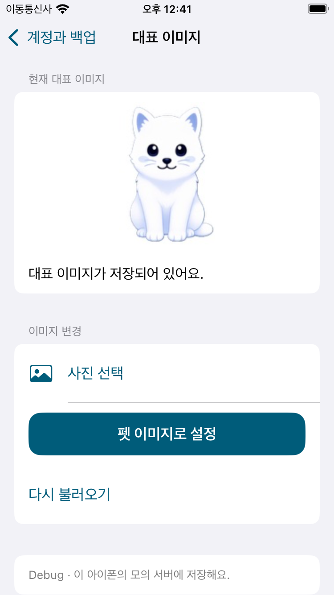
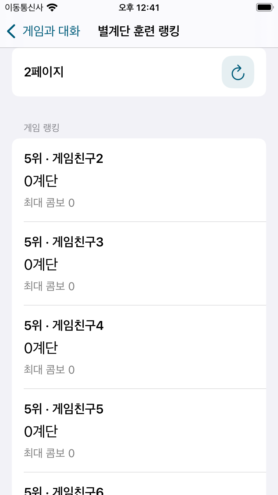
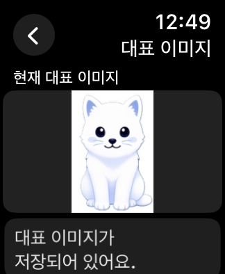

# Swagger API·Android 동작 대조 — 2026-11-13

**Swagger 25개 중 iOS/watchOS 앱에서 사용하는 경로는 19개(일반 18개 + 갱신 예비 1개)다.** 나머지 6개는 Apple로 대체한 Google 로그인, 미사용 별칭, 진단용 경로다. Android는 15개를 사용한다. 여기서 사용은 앱의 실제 기능에서 호출 경로에 도달할 수 있다는 뜻이며, 운영 서버에서 모든 요청을 실행했다는 뜻은 아니다.

기준: [Swagger 명세](https://www.stepmatecp.com/v3/api-docs), [Android 소스 고정 버전](https://github.com/Chaeros/StepMate/tree/4e2b5e54902efd9630dc5fe7595ca0fb2656d0e3). 명세 해시와 경로별 Android 소스는 [검증 JSON](Verification/APIParity-2026-11-13.json)에 남겼다. `develop`의 `0cfb3fd`에서 `feature/android-api-ui-parity`를 만들었다.

## 전체 25개 분류

Android 소스의 Retrofit 선언뿐 아니라 repository·화면의 호출과 출력도 확인했다. iOS의 일반/예비 경로는 공용 `BackendClient`를 사용하며, 워치는 단독 호출 또는 아이폰 중계를 선택한다.

| 요청 | iOS 상태 | Android | 동작·출력 또는 미사용 이유 |
|---|---|---|---|
| `POST /api/v1/star-stair-game/rank/score` | 사용 | 사용 | 별계단 게임 종료 시 기록 저장. Android도 응답의 best/updated는 직접 표시하지 않음 |
| `POST /api/v1/star-stair-game/rank/position` | 사용 | 사용 | 별계단 게임 결과의 예상 순위. 제출 점수·콤보는 현재 게임 기록 표시 |
| `POST /api/v1/shooting-game/rank/score` | 사용 | 사용 | 슈팅 게임 종료 시 기록 저장. Android도 응답의 best/updated는 직접 표시하지 않음 |
| `POST /api/v1/shooting-game/rank/position` | 사용 | 사용 | 슈팅 게임 결과의 예상 순위. 제출 점수·콤보는 현재 게임 기록 표시 |
| `POST /api/v1/backup` | 사용 | 사용 | 백업 성공·실패 안내. savedStepCountDays는 Android도 숫자로 표시하지 않음 |
| `POST /api/v1/auth/refresh` | 사용 | 사용 | 401/403 뒤 인증 갱신. 토큰과 만료 메타데이터는 내부 사용 |
| `POST /api/v1/refresh` | 조건부 사용 | 사용 | 기본 갱신 경로가 404/405일 때만 사용하는 예비 경로 |
| `POST /api/auth/refresh` | 미사용 | 미사용 | 갱신 별칭; Android도 미사용 |
| `POST /api/v1/google` | 미사용 | 사용 | Android는 사용. iOS는 사용자가 선택한 Apple 로그인으로 대체; Google 클라이언트 계약만 존재 |
| `POST /api/v1/auth/google` | 미사용 | 미사용 | Google 로그인 별칭; Android도 미사용 |
| `POST /api/auth/google` | 미사용 | 미사용 | Google 로그인 별칭; Android도 미사용 |
| `POST /api/v1/ai/chat/stream` | 사용 | 사용 | 워치·아이폰 질문 입력 → 스트리밍 답변·완료·오류·취소 상태 |
| `PATCH /api/v1/users/nickname` | 사용 | 사용 | 닉네임 편집 → 계정 표시명 갱신·중복/실패 안내 |
| `PATCH /api/v1/users/me/picture` | 사용 | 미사용 | 워치·아이폰 대표 이미지 변경 → 업로드한 이미지·저장 상태 |
| `GET /api/v1/users/nickname/check` | 사용 | 사용 | 닉네임 편집 → 중복 여부와 사용 가능 안내 |
| `GET /api/v1/users/me` | 사용 | 미사용 | 계정 닉네임·대표 이미지 조회. googleId는 화면에 노출하지 않음 |
| `GET /api/v1/usermates/{mateId}` | 사용 | 사용 | 복원 미리보기·적용 및 아이폰 서버 펫 정보(레벨·경험치·애정·기분·능력치) |
| `GET /api/v1/test/t2` | 미사용 | 미사용 | 연결 진단용; Android도 미사용, 사용자 기능 없음 |
| `GET /api/v1/test/t1` | 미사용 | 미사용 | 연결 진단용; Android도 미사용, 사용자 기능 없음 |
| `GET /api/v1/stepcounts/ranking` | 사용 | 미사용 | 누적 걸음수 랭킹 → rank·nickname·totalStepCount·전체 인원·페이지 |
| `GET /api/v1/stepcounts/me` | 사용 | 사용 | 날짜별 걸음수·월별 스트릭·복원 |
| `GET /api/v1/star-stair-game/rank/top10` | 사용 | 사용 | 별계단 TOP 10 → rank·userName·maxStep·maxCombo |
| `GET /api/v1/star-stair-game/rank/range` | 사용 | 미사용 | 별계단 구간 랭킹 → 전체 순위·닉네임·계단·최대 콤보·페이지 |
| `GET /api/v1/shooting-game/rank/top10` | 사용 | 사용 | 슈팅 TOP 10 → rank·userName·score |
| `GET /api/v1/shooting-game/rank/range` | 사용 | 미사용 | 슈팅 구간 랭킹 → 전체 순위·닉네임·점수·페이지 |

## 이번 변경

- **아이폰 계정과 백업 → 누적 걸음수 랭킹**: 순위·닉네임·누적 합계·전체 인원, 5명씩 이전/다음 페이지와 새로고침을 제공한다.
- **아이폰 게임과 대화 → 게임 선택 → 전체 랭킹**: 슈팅 점수, 별계단 수·최대 콤보를 페이지별로 표시한다. 기존 TOP 10도 유지한다.
- **아이폰 계정과 백업 → 대표 이미지 변경**: 사진 선택 또는 펫 이미지 업로드, 계정 헤더 이미지, 재조회·재실행 유지. 워치가 아이폰을 중계해 변경한 이미지도 아이폰 화면에 반영한다.
- **워치 게임 결과**: Android와 같은 “예상 순위”로 표시한다. 점수 저장·예상 순위 조회 뒤 TOP 10만 실패하면 성공한 순위를 유지하고 실패 안내와 재시도를 제공한다. 실패한 조회를 빈 랭킹으로 안내하지 않는다.
- 계정 전환·로그아웃·취소 뒤 늦은 페이지/이미지/게임 응답을 폐기한다. 다음 페이지 조회 실패는 이전 목록을 유지한다.

## Android와 맞춘 출력 범위

Android의 `FoxGameScreen`·`HeavenStairsGameScreen`은 점수 저장 후 예상 순위와 TOP 10을 보여준다. `ScoreSaveResponse.updated/bestScore`, 별계단 저장 응답의 best 값은 직접 표시하지 않는다. iOS도 서버 저장 성공 여부와 예상 순위·TOP 10을 표시하고, 로컬 최고 기록은 별도로 유지한다.

백업의 `savedStepCountDays`는 Android도 화면에 표시하지 않고 성공·실패를 안내한다. 토큰·googleId 등 내부 식별/인증 값은 화면용 출력이 아니다. `users/me`, 대표 이미지 변경, 누적 걸음수 랭킹, 게임 구간 랭킹 두 개는 Android의 해당 소스에는 호출이 없지만, 앞서 요청한 iOS 확장 기능으로 유지하고 이번에 아이폰 화면까지 연결했다.

현재 사용자가 선택한 iOS 로그인은 Apple이다. Google 별칭이나 진단 API를 호출해야 같은 기능이 되는 것은 아니므로 추가 로그인 버튼·진단 화면은 만들지 않았다. `POST /api/v1/auth/apple`은 현재 Swagger에 없으며 [서버 연동 명세](AppleSignInServer.md)의 외부 설정이 필요하다. Debug의 로컬 로그인 경로는 운영 API에 포함되지 않는다.

## 검증

- Core **207개 통과**: 기존 계약, 부분 성공·재시도, 인증 만료·취소·로그아웃, 단독/중계 프로필 반영.
- 아이폰 모델 **12개**, UI **5개 흐름 통과**: iPhone SE 3세대/iOS 18 시뮬레이터에서 누적·슈팅·별계단 페이지 왕복과 출력, 대표 이미지 재실행 유지, 큰 글자·다크 모드·44pt 버튼.
- 워치 모델 **11개**, UI **5개 흐름 통과**: 페어링 없는 SE 2세대 40mm/watchOS 11에서 누적·슈팅·별계단 페이지 왕복, 대표 이미지 재실행 유지, 별계단 종료 → 점수 저장·예상 순위·TOP 10 → 재실행·랭킹 새로고침.
- 아이폰·워치 **Release 시뮬레이터 빌드 통과**. 두 바이너리에서 `LocalDevelopmentBackend`·`signInForDevelopment` 심볼이 없는 것을 확인했다.
- Debug 모의 계정과 시뮬레이터만 사용했다. 사진 라이브러리의 개인 사진은 선택하지 않았고, 같은 업로드 경로의 펫 이미지 버튼을 검사했다.
- 운영 서버 로그인·쓰기는 실행하지 않았다. 실서버 인증/권한/배포 결과는 이 검증으로 보장하지 않는다. 단독 Debug 서버는 기기별 파일이며 서로 공유하는 운영 서버가 아니다.

구현 커밋: `afed125`(아이폰 API 화면·프로필 연동), `a9765a8`(워치 게임 결과 부분 성공 처리). 결과 번들과 캡처 경로는 검증 JSON에 기록했다.

