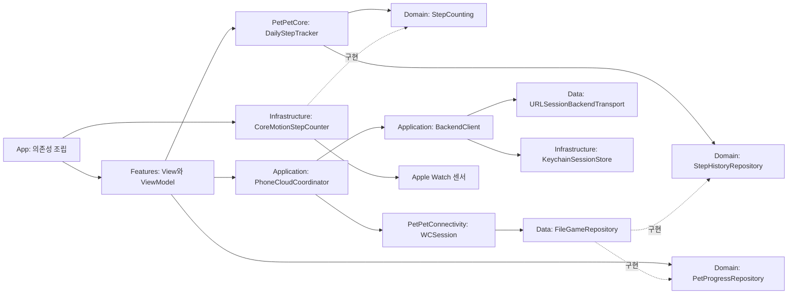

# PetPet iOS·watchOS 구조

## 현재 완료 범위

워치 홈, 하루 걸음수, 먹이·성장·스탯·호감도, iPhone 표시용 동기화를 구현했다. iPhone과 워치에는 Apple 로그인·각 기기의 Keychain 세션과 StepMate 백업·복원 클라이언트를 연결했으며, 워치는 서버 성공 확인 뒤 보상을 지급한다. Apple 인증 서버 추가와 capability 프로파일 설정·실제 계정 검증이 남아 있다. [설정과 검증 범위](AccountAndBackup.md).

기본 Debug는 모의 로그인과 각 호스트 기기 내부의 영구 모의 백엔드를 사용하며, 무료 Personal Team으로 기기에 설치한다. 게임·수신 캐시·백업·Keychain을 Release와 분리하고, 기존 워치 상태를 개발용 공간에 한 번 복사한다. [개발 모드](DebugTesting.md).

워치의 월별 로컬 스트릭과 아이폰의 서버 기록 히트맵, 양쪽 닉네임 편집기를 구현했다. `StepStreak`와 `NicknameEditor`는 공용 규칙을, `PhoneProfileCoordinator`·`WatchNicknameRelay`는 인증 API와 워치 요청의 경계를 담당한다. [규칙과 검증](StreakAndNickname.md).

게임 2종·영구 최고 기록·랭킹과 시스템 음성 입력·AI SSE 대화도 구현했다. 인증 요청은 아이폰이 담당하며 Debug는 외부 통신 없는 모의 백엔드를 사용한다. [게임과 대화](GamesAndChat.md).

```text
PetPet/                         iPhone 앱 타깃
  App/                          앱 시작점과 의존성 조립
  Features/Home/Presentation/    SwiftUI 화면과 ViewModel
  Features/Account/Presentation/ Apple 로그인·백업·복원 미리보기
  Features/Streak/Presentation/  서버 백업 기록·365일 히트맵
  Features/Profile/Presentation/ 닉네임 입력과 중복·변경 상태
  Features/Companion/Presentation/ 게임 랭킹·AI 대화
  Features/WatchSetup/Presentation/ 페어링·설치·동기화 안내
  Infrastructure/Account/       AuthenticationServices·Keychain 어댑터
  Preview Content/              Debug 전용 미리보기
PetPet Watch App/               watchOS 앱 타깃
  App/                          앱 시작점과 의존성 조립
  Features/Home/Presentation/    워치 홈과 화면 상태
  Features/Pet/Presentation/     성장·스탯 화면과 펫 상태
  Features/Food/Presentation/    먹이 목록·소비·보상 수령 화면
  Features/Account/Presentation/ 계정·서버 백업 상태
  Features/Streak/Presentation/  로컬 스트릭·월별 기록·날짜 선택
  Features/Profile/Presentation/ watchOS 시스템 입력 기반 닉네임 편집
  Features/Character/Presentation/ 네이티브 캐릭터 반응
  Features/Games/Presentation/   게임 선택·SpriteKit 슈팅·별계단·랭킹
  Features/Chat/Presentation/    시스템 입력·AI 대화
  Infrastructure/Account/       워치 Apple 인증·Keychain·단독 호스트 조립
  Infrastructure/Motion/        CoreMotion 어댑터
  Infrastructure/Connectivity/ 워치 변경 감지와 전송 조립
  Preview Content/              센서를 사용하지 않는 미리보기
Packages/PetPetCore/
  Sources/PetPetCore/Domain/     공용 모델과 서비스·저장소 계약
  Sources/PetPetCore/Application/ 하루 집계·구독·복구·날짜 전환
  Sources/PetPetCore/Data/Local/  원자적 로컬 기록 저장
  Sources/PetPetCore/Data/Remote/ 서버 DTO와 URLSession 전송
  Tests/PetPetCoreTests/         기기 없이 실행하는 동작 테스트
  Sources/PetPetConnectivity/   iOS·watchOS 공용 WatchConnectivity 어댑터
```

## 의존성과 상태 흐름



- View는 화면과 사용자 입력을 담당한다. 센서·네트워크·저장소에 직접 접근하지 않는다.
- ViewModel은 `@MainActor`에서 화면 상태를 발행한다. 센서 구현은 생성자로 주입한다.
- 워치 루트는 `NavigationStack` 안의 `TabView(.verticalPage)`다. Android의 메인 정보 구조에 맞춰 크라운으로 홈·상태·게임·스트릭·음성의 5개 페이지를 전환한다. 홈은 전체 배경과 중앙 펫·걸음수로 구성하고, 먹이·스탯 편집은 상태 화면에서, 계정·백업은 스트릭 상세에서 스택에 연다. 루트의 추적 수명은 섹션·상세 화면 이동과 분리한다. [Apple의 크라운 페이지 전환 지침](https://developer.apple.com/videos/play/wwdc2023/10031/?time=347)을 따른다. 원본 비교와 watchOS 차이는 [워치 홈 구성 검토](WatchHomeParity-2026-11-12.md)에 기록한다.
- `PetPetCore`는 SwiftUI, CoreMotion, WatchConnectivity에 의존하지 않는다. iPhone과 Watch 타깃이 같은 로컬 Swift Package를 참조한다.
- 같은 패키지의 별도 제품 `PetPetConnectivity`만 WatchConnectivity를 가져온다. 앱마다 WCSession 소유자는 한 개이며, SDK의 백그라운드 콜백을 MainActor로 넘긴다. `PhoneSnapshotReceiver`와 `WatchSnapshotPublisher`는 SDK 대신 주입 가능한 `SnapshotTransport` 계약을 사용한다.
- `DailyStepTracker`는 저장값 복원, 자정부터의 누적 집계, 최근 기록 복구, 중복/지연 콜백, 날짜 변경을 처리한다. 센서·저장 오류는 화면까지 전달한다.
- 플랫폼 SDK는 `Infrastructure/<Capability>`에 둔다. 공용 Foundation 파일 저장은 `PetPetCore/Data/Local`에서 Domain 계약을 구현한다. SDK 전용 저장소와 서버 구현은 기능별 `Data`에 배치한다. 화면에서 직접 `URLSession`이나 파일에 접근하지 않는다.
- `PhoneAppModel`과 `WatchAppModel`이 앱 시작 시 의존성과 단일 WCSession을 조립한다. 백그라운드 전송도 화면 생성에 의존하지 않는다.
- 선택한 호스트의 `BackendClient`가 인증·공유 refresh·API 호출을, iPhone `KeychainSessionStore` 또는 워치 `WatchKeychainSessionStore`가 각자 토큰 저장을 담당한다. 서버 DTO와 토큰은 펫 모델이나 워치 전송에 섞지 않는다.

## 현재 동작과 다음 변경의 경계

- 워치 걸음수는 기기의 현재 시간대에서 자정부터의 합계다. 저장된 오늘 기록을 먼저 표시한 뒤 CoreMotion 구간 조회·실시간 누적값으로 보정한다. 자정 타이머와 날짜/시간대 변경 알림, 앱 복귀 시 새 날짜를 확인한다.
- 날짜별 기록은 펫·먹이와 함께 Application Support/PetPet/game-state-v1.json에 저장한다. 기존 날짜별 파일과 펫 파일을 최초 이관하고 원본은 보존한다. actor에서 직렬화하고 원자적으로 교체한다.
- CoreMotion이 제공하는 최근 약 7일 범위에서 오늘과 이전의 완전한 날짜 구간을 복구한다. 앱이 장기간 실행되지 않아 센서 보관 범위를 벗어난 미저장 기록은 복구할 수 없다. 자세한 정책은 [하루 걸음수](DailySteps.md)를 따른다.
- 워치의 시간대 배경은 Android 원본을, 달리기·인사는 이를 참조한 16프레임 에셋을 사용한다. `PetAnimationState`·`PetSpriteAnimation`이 재생 규칙을, `PetPlaybackRequest`가 재시작 여부를 정한다. 워치는 SpriteKit 텍스처 사전 로드와 동작을, 아이폰은 UIKit 애니메이션을 사용한다. 별도 가속도계 구독은 시작하지 않는다. [네이티브 재생과 검증](NativePetAnimations.md).
- iPhone은 실제 수신한 오늘 걸음수·펫 상태·보유 먹이와 마지막 동기화 시각을 표시한다. 최초 수신 전과 오늘 날짜의 기록이 없을 때는 `—`를 표시한다. 미리보기 데이터는 `Preview Content`에만 둔다. [동기화 정책](WatchSynchronization.md).
- 워치 수신 기록이 없고 로그인되어 있으면 서버 펫을 읽기 전용으로 표시한다. `FileAccountPetCache`는 계정별 펫과 조회 시각만 저장하며 워치 복원·보상·먹이를 변경하지 않는다. 공통 BackendClient 인증 무효화 알림으로 계정 화면과 워치 상태를 갱신한다. [아이폰 검토](PhoneAudit-2026-11-08.md).
- `PetProfile`, `PetMood`, `FoodDefinition`, `FoodInventoryItem`, `PetStatistic`, `UserProfile`, `DailyStepRecord`는 Android의 실제 모델을 참고한 공용 타입이다. 이들의 Codable 표현을 서버 요청 DTO로 바로 사용하지 않는다. 날짜 포맷과 JSON 키는 각 API 계약에 맞는 별도 DTO에서 변환한다.
- `FileGameRepository`는 펫·먹이·걸음수·날짜별 지급 내역·복원을 하나의 트랜잭션으로 저장한다. 보상은 선택한 호스트가 서버 성공을 기록한 영수증을 적용할 때만 지급한다. 이전 로컬 지급 헬퍼는 기존 파일 구현의 테스트·이관 참고용이며 실제 앱 화면에서 호출하지 않는다. [상세 규칙](FeedingAndGrowth.md).
- `StepHistoryRepository`는 날짜별/전체 기록 조회를 제공한다. 서버 백업은 전체 기록을 별도 파일로 내보내며 표시용 7일 캐시를 사용하지 않는다. 게임 규칙은 공용 엔진, 최고 기록은 별도 파일에 둔다. `PhoneFeatureCoordinator`가 인증된 랭킹·AI 요청을 수행하고 워치에 제한 크기 응답을 전송한다.
- 빈 `GestureEvent`와 사용되지 않던 사용자·캐릭터 모델 초안은 정리했다. 캐릭터 기분과 애니메이션 상태는 각각 `PetMood`와 `CharacterActivity`로 구분한다.

## 기능을 추가하는 순서

1. 하루 걸음수 집계·날짜 변경·재실행 복구와 로컬 저장: 완료.
2. Android와 같은 보상 수치, 먹이 소비, 경험치·레벨·스탯·호감도 규칙: 완료. 기분 표시·터치와 원본 펫 프레임·시간대 배경도 연결했다.
3. iPhone 보조 홈과 WatchConnectivity 읽기 전용 동기화: 완료. 기기별 센서 값을 단순 합산하지 않는다.
4. Apple 인증, Keychain 세션, 서버 백업·복원 클라이언트: 코드 구현 완료. 서버 Apple 인증과 개발자 팀 설정·실제 계정 검증 필요. 스트릭·닉네임 UI와 Debug 모의 프로필도 구현했다.
5. 게임 2종, 랭킹, 음성·AI 대화: 클라이언트·Debug 모의 서버 구현 완료. [구현과 시뮬레이터 검증](GamesAndChat.md). 운영 계정/서버 검증은 4단계 설정 이후 진행한다.

각 단계에서 실제 Android 코드의 규칙·API DTO를 확인한 뒤 이식한다. 워치 백그라운드 동작은 Wear OS의 센서 구독을 그대로 복제하지 않고 Apple 플랫폼에서 지원하는 수집 방식과 실행 수명에 맞춰 구현한다.

## 검증

```sh
swift test --package-path Packages/PetPetCore
xcodebuild -project PetPet.xcodeproj -scheme PetPet -configuration Debug -destination 'generic/platform=iOS Simulator' CODE_SIGNING_ALLOWED=NO build
xcodebuild -project PetPet.xcodeproj -scheme 'PetPet Watch App' -configuration Release -destination 'generic/platform=watchOS Simulator' CODE_SIGNING_ALLOWED=NO build
```

실기기에서는 동작 및 피트니스 권한 허용 후 오늘 걸음수 증가를 확인하고, 화면을 벗어나거나 앱을 재실행해도 오늘 값이 유지·복구되는지 확인한다. 날짜 전환은 새 날짜를 시작하고 이전 기록을 보존해야 한다. 권한 거부·센서 미지원·저장 실패는 안내 문구로 표시한다.

## 워치 단독 서버 호스트 (2026-11-12)

`WatchStandaloneService`가 워치 인증·백업·복원과 성공 저널을 소유한다. `WatchFeatureRouter`는 단독/아이폰 중계를 요청 전에 선택하고 채팅 경로를 고정한다. 기존 `BackendClient`와 `PhoneFeatureCoordinator`의 HTTP·refresh·SSE·취소/epoch 검사를 두 호스트에서 재사용한다. 워치 `WatchKeychainSessionStore`는 서버별 별도 service와 `AfterFirstUnlockThisDeviceOnly`를 사용한다. mode·계정 표시·영수증 파일에 자격 증명을 쓰지 않는다. `WKRunsIndependentlyOfCompanionApp=true`이며 iPhone 앱은 계속 companion으로 남는다. [단독 연결 상세](WatchStandalone-2026-11-12.md).
