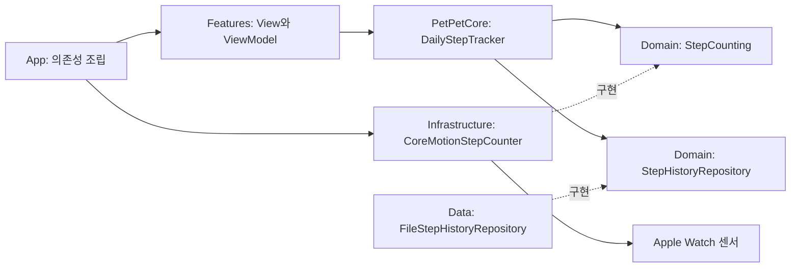

# PetPet iOS·watchOS 구조

## 현재 완료 범위

워치 홈, 하루 걸음수 집계, 날짜별 로컬 저장까지 구현했다. iPhone은 Android의 폰 앱처럼 로그인·조회·동기화 보조 역할을 맡는 방향으로 둔다. 서버는 기존 StepMate API 재사용을 기본 방향으로 하되 아직 연결하지 않는다.

```text
PetPet/                         iPhone 앱 타깃
  App/                          앱 시작점과 의존성 조립
  Features/Home/Presentation/    SwiftUI 화면과 ViewModel
  Preview Content/              Debug 전용 미리보기
PetPet Watch App/               watchOS 앱 타깃
  App/                          앱 시작점과 의존성 조립
  Features/Home/Presentation/    워치 홈과 화면 상태
  Features/Character/Presentation/ 캐릭터 반응 초안
  Infrastructure/Motion/        CoreMotion 어댑터
  Preview Content/              센서를 사용하지 않는 미리보기
Packages/PetPetCore/
  Sources/PetPetCore/Domain/     공용 모델과 서비스·저장소 계약
  Sources/PetPetCore/Application/ 하루 집계·구독·복구·날짜 전환
  Sources/PetPetCore/Data/Local/  원자적 로컬 기록 저장
  Tests/PetPetCoreTests/         기기 없이 실행하는 동작 테스트
```

## 의존성과 상태 흐름



- View는 화면과 사용자 입력을 담당한다. 센서·네트워크·저장소에 직접 접근하지 않는다.
- ViewModel은 `@MainActor`에서 화면 상태를 발행한다. 센서 구현은 생성자로 주입한다.
- `PetPetCore`는 SwiftUI, CoreMotion, WatchConnectivity에 의존하지 않는다. iPhone과 Watch 타깃이 같은 로컬 Swift Package를 참조한다.
- `DailyStepTracker`는 저장값 복원, 자정부터의 누적 집계, 최근 기록 복구, 중복/지연 콜백, 날짜 변경을 처리한다. 센서·저장 오류는 화면까지 전달한다.
- 플랫폼 SDK는 `Infrastructure/<Capability>`에 둔다. 공용 Foundation 파일 저장은 `PetPetCore/Data/Local`에서 Domain 계약을 구현한다. SDK 전용 저장소와 서버 구현은 기능별 `Data`에 배치한다. 화면에서 직접 `URLSession`이나 파일에 접근하지 않는다.
- 인증 토큰 저장은 후속 인증 단계에서 Keychain 어댑터로 구현한다. 서버 DTO와 토큰은 펫 모델이나 View에 섞지 않는다.

## 현재 동작과 다음 변경의 경계

- 워치 걸음수는 기기의 현재 시간대에서 자정부터의 합계다. 저장된 오늘 기록을 먼저 표시한 뒤 CoreMotion 구간 조회·실시간 누적값으로 보정한다. 자정 타이머와 날짜/시간대 변경 알림, 앱 복귀 시 새 날짜를 확인한다.
- 날짜별 기록은 워치 앱 컨테이너의 Application Support/PetPet/step-history-v1.json에 저장한다. 파일 저장은 actor에서 직렬화하고 원자적으로 교체한다. 저장된 기록은 계속 유지하며, 재실행 시 복구한다.
- CoreMotion이 제공하는 최근 약 7일 범위에서 오늘과 이전의 완전한 날짜 구간을 복구한다. 앱이 장기간 실행되지 않아 센서 보관 범위를 벗어난 미저장 기록은 복구할 수 없다. 자세한 정책은 [하루 걸음수](DailySteps.md)를 따른다.
- 워치의 정지 캐릭터, 배경, 시각 표시는 유지한다. 기존 움직임·터치 반응 초안은 별도 ViewModel/센서 어댑터로 분리했으며 홈 애니메이션에는 아직 연결하지 않았다.
- iPhone의 임의 숫자 표시는 제거했다. 실제 기록을 받기 전에는 `—`를 표시한다. 미리보기 데이터는 `Preview Content`에만 둔다.
- `PetProfile`, `PetMood`, `FoodDefinition`, `FoodInventoryItem`, `PetStatistic`, `UserProfile`, `DailyStepRecord`는 Android의 실제 모델을 참고한 공용 타입이다. 이들의 Codable 표현을 서버 요청 DTO로 바로 사용하지 않는다. 날짜 포맷과 JSON 키는 각 API 계약에 맞는 별도 DTO에서 변환한다.
- `StepHistoryRepository`는 실제 파일 저장과 날짜별/전체 기록 조회를 구현했다. `PetRepository`의 펫 저장, WatchConnectivity 동기화, 인증·백업·랭킹·음성 API는 후속 단계다.
- 빈 `GestureEvent`와 사용되지 않던 사용자·캐릭터 모델 초안은 정리했다. 캐릭터 기분과 애니메이션 상태는 각각 `PetMood`와 `CharacterActivity`로 구분한다.

## 기능을 추가하는 순서

1. 하루 걸음수 집계·날짜 변경·재실행 복구와 로컬 저장: 완료.
2. Android와 같은 보상, 먹이 소비, 경험치·레벨·스탯·호감도 규칙과 캐릭터 반응.
3. iPhone 보조 홈과 WatchConnectivity 동기화. 기기별 센서 값을 단순 합산하지 않는다.
4. Google 인증, Keychain 세션, 기존 서버의 백업·복원·스트릭·닉네임 API.
5. 게임 2종, 랭킹, 음성·AI 대화.

각 단계에서 실제 Android 코드의 규칙·API DTO를 확인한 뒤 이식한다. 워치 백그라운드 동작은 Wear OS의 센서 구독을 그대로 복제하지 않고 Apple 플랫폼에서 지원하는 수집 방식과 실행 수명에 맞춰 구현한다.

## 검증

```sh
swift test --package-path Packages/PetPetCore
xcodebuild -project PetPet.xcodeproj -scheme PetPet -configuration Debug -destination 'generic/platform=iOS Simulator' CODE_SIGNING_ALLOWED=NO build
xcodebuild -project PetPet.xcodeproj -scheme 'PetPet Watch App' -configuration Release -destination 'generic/platform=watchOS Simulator' CODE_SIGNING_ALLOWED=NO build
```

실기기에서는 동작 및 피트니스 권한 허용 후 오늘 걸음수 증가를 확인하고, 화면을 벗어나거나 앱을 재실행해도 오늘 값이 유지·복구되는지 확인한다. 날짜 전환은 새 날짜를 시작하고 이전 기록을 보존해야 한다. 권한 거부·센서 미지원·저장 실패는 안내 문구로 표시한다.
