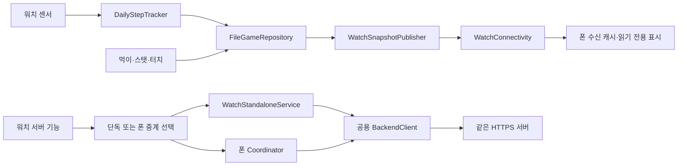

# Android·iOS 개발 공유 안내

2026-11-14 기준. Android 개발자가 Apple 저장소의 구조와 구현 범위를 확인하고, 먼저 개발된 기능을 가져갈 때 사용하는 시작 문서다.

## 현재 공유 기준

| 구분 | 기준 | 상태 |
|---|---|---|
| Android | `Chaeros/StepMate` main `4e2b5e54902efd9630dc5fe7595ca0fb2656d0e3` | 현재 비교 기준 |
| Apple 통합 | develop `33b9945` | 전체 흐름 점검 기능을 통합한 기준 |
| 꾸미기 선행 개발 | `feature/pet-customization` / `01b38a7`, `3d3ea67`, `4fbf6b6` | 코드·Debug/Release 빌드 완료, develop 미통합, 실행 검토 대기 |
| 별계단 동작 보완·공유 문서 | `feature/star-stair-feedback` / 구현 `0f4a7e1` | 위 develop에서 독립 분기. Debug/Release·Core 컴파일 완료, 실행 검토 대기. [작업 기록](../StarStairFeedback-2026-11-14.md) |

이 브랜치에는 꾸미기 코드를 합치지 않았다. 꾸미기 내용은 아래 인계 문서에 별도로 정리했다. 브랜치·커밋을 전달할 때는 원격에 실제로 올라가 있는지와 PR 링크를 확인한다.

## 구현된 기능

| 영역 | Apple 측 구현 | 상태·주의점 |
|---|---|---|
| 걸음수·로컬 기록 | 워치 일일 집계, 자정·시간대 전환, 재실행·최근 기록 복구 | 워치가 원본. 폰 센서와 합산하지 않음 |
| 먹이·성장·스탯 | 우유/사과/고기 경험치 1/3/5, 레벨×2 필요 경험치, 레벨업당 포인트 +2 | 같은 펫·먹이·지급 내역을 원자적으로 저장 |
| 터치·기분 | 유효한 쓰다듬기 50회당 애정 +1, 식사/활동 상태 갱신 | 달리기·인사 중 중복 터치 차단. 공복·미접속이 겹치면 공복 우선 |
| 보상 | 서버 백업 성공 뒤 1,000보 단위 우유와 일일 사과 | 성공 영수증·날짜별 이력으로 중복 지급 방지 |
| 폰 표시·동기화 | 오늘 걸음수·펫·먹이·최종 수신 시각, 수동 갱신·수신 캐시 | 최신 표시용 최근 7일 스냅샷. 서버 백업의 전체 기록과 구분 |
| 스트릭·닉네임 | 워치 로컬 달력·날짜 선택·연속 일수, 폰 서버 기록 히트맵, 닉네임 중복 검사·변경 | 연속 일수는 하루 1보 이상. 10,000보 목표와 별개 |
| 게임 | 지구를 지켜라·별계단, 로컬 최고 기록, 서버 점수·예상 순위·TOP 10 | 별계단 방향별 반응·시간 초과 햅틱은 이번 feature에서 보완 |
| 추가 랭킹·대표 이미지 | 누적 걸음수, 두 게임 구간 페이지, 이미지 변경·재조회 | 비교한 Android 소스에는 미호출인 iOS 추가 기능 |
| AI | 입력·SSE 답변·중단·오류·전체 답변 표시 | 질문 2,000자/8KB, 답변 24KB 제한. Debug는 모의 답변 |
| 백업·복원 | 미리보기·확정·취소, 계정 확인·중복/역순 방지 | 운영 서버 인증 연동 확인은 별도 |
| 워치 단독 사용 | 워치 자체 세션으로 닉네임·백업·복원·랭킹·AI 호출 | 단독/폰 중계를 명시적으로 선택. 실패한 변경 요청을 다른 경로로 재전송하지 않음 |
| 캐릭터·배경·동작 | 눈여우 1종, 배경 자동/고정 선택, 동작 카탈로그·미리보기 | 독립 꾸미기 feature에만 있음. [인계 내용](FeatureHandoff.md#선행-개발-예시-캐릭터배경동작) |

기능 구현·빌드 성공·모의 계정 실행·운영 서버 확인은 각각 다른 상태로 기록한다. 과거 전체 점검은 Core 213개·앱 모델 42개·UI 실행 47개를 모의 환경에서 확인했다. 이는 [2026-11-13 점검](../FullFlow-2026-11-13.md)의 결과이며 이번 작업에서 재실행한 수치가 아니다.

## 구조 대응표

두 플랫폼이 같은 실행 파일이나 Swift 패키지를 공유하는 구조는 아니다. **동작 규칙·데이터 의미·API 계약·리소스 ID를 공유**하고 각 플랫폼 코드로 구현한다.

| 책임 | Android | iOS·watchOS |
|---|---|---|
| 워치 화면 | `app/.../feature_*/presentation` / Compose | `PetPet Watch App/Features/*/Presentation` / SwiftUI |
| 폰 화면 | `mobile/.../feature_*/presentation` | `PetPet/Features/*/Presentation` |
| 화면 상태·입력 | 기능별 ViewModel·StateFlow | 기능별 ViewModel·`@MainActor`·ObservableObject |
| 게임·성장 규칙 | 기능별 repository/engine의 Kotlin 로직 | `Packages/PetPetCore/Sources/PetPetCore/Domain` |
| 기능 흐름·조정 | repository·ViewModel·네트워크 공통 모듈 | `PetPetCore/Application`의 Tracker·Coordinator·Service |
| 로컬 저장 | Room·SharedPreferences | `PetPetCore/Data/Local` actor·원자적 파일 저장 |
| 서버 계약 | Retrofit DTO·API service, AI 스트림 클라이언트 | `PetPetCore/Data/Remote`, 공용 `BackendClient` |
| 센서 | SensorManager·TYPE_STEP_COUNTER | 워치 `Infrastructure/Motion` / CoreMotion |
| 기기 간 통신 | Wearable MessageClient 등 | `PetPetConnectivity` / WCSession 한 개씩 |
| 의존성 조립 | Application·Activity·Hilt | `PhoneAppModel`, `WatchAppModel` |

화면에서 센서·저장·HTTP 로직을 직접 복사하지 않는다. 플랫폼 코드의 디렉터리를 그대로 맞추기보다 같은 책임과 규칙이 어디에 있는지 대응시킨다. [실제 Apple 디렉터리](../Architecture.md).

## 데이터와 서버 요청의 소유권

- **워치:** 현재 펫·먹이·능력치·걸음수·터치 중간 횟수·보상 저널·게임 로컬 최고 기록을 소유한다. 폰은 수신 스냅샷으로 워치 원본을 임의 편집하지 않는다.
- **폰:** 받은 표시용 스냅샷과 계정별 서버 조회 캐시를 소유한다. 오래된 서버 백업과 실시간 워치 상태를 화면에서 구분한다.
- **서버:** 인증된 내부 계정, 닉네임·대표 이미지, 백업된 펫·날짜별 걸음수, 서버 랭킹을 소유한다. 클라이언트가 서버 응답 DTO와 로컬 모델을 같은 형식으로 취급하지 않는다.
- **호스트:** 단독이면 워치, 중계이면 폰이 HTTP·토큰 갱신·SSE를 처리한다. 각 기기는 자기 Keychain 세션을 사용하며 로그인 토큰을 일반 스냅샷에 넣지 않는다.
- **꾸미기:** 선행 feature에서는 워치 단위의 별도 로컬 설정이며 폰으로 선택 정보를 전송한다. 서버 백업 항목은 아니다.

## Android와 의도적으로 다른 범위

- 입력·탐색·시계·저휘도·접근성은 플랫폼에 맞게 구성한다. 같은 페이지 전환 제스처를 강제하지 않는다.
- iOS의 슈팅은 고정 시간 간격으로 계산한다. 화면 프레임 수에 따라 진행 속도가 달라지는 원본 동작은 복제하지 않는다.
- iOS는 공복 우선순위와 날짜별 보상 이력을 명확히 해 경합·날짜 재방문 중 중복 지급을 막는다.
- iOS에는 긴 AI 질문/답변 제한과 명시적인 응답 중단 기능이 있다.
- Android의 폰 버튼은 워치 스토어 페이지를 원격으로 연다. 현재 iOS는 수동 설치 안내를 제공한다. 이번 별계단 수정에는 이 설치 흐름을 포함하지 않는다.
- iOS의 걸음수는 앱 복귀 시 시스템 기록을 보정하며, 미저장 과거 기록 복구는 현재 오늘+이전 최대 6일 범위다. 즉시 상시 동기화나 장기 미실행 기록의 무제한 복구를 보장하지 않는다. Android에도 선언된 권한만으로 상시 수집 서비스가 구현되었다고 판단하지 않는다.

## 서버 개발자에게 요청할 작업

기존 Swagger의 일반 기능 API는 클라이언트에 연결했다. Apple 로그인 경로는 **클라이언트가 준비한 계약**이며 서버 배포 완료를 뜻하지 않는다.

1. `POST /api/v1/auth/apple`의 증명 검증과 내부 사용자·세션 발급을 구현한다.
2. iPhone·watch App ID audience와 각 기기의 독립 세션·refresh 회전을 지원한다.
3. 서버 코드가 Google ID만으로 사용자를 조회하는 부분을 내부 user ID 기준으로 이행하고 기존 Android API를 유지한다.
4. 그 계정으로 닉네임·랭킹·AI·백업/복원이 동작하는지 운영 전 확인한다.

[요청·응답 및 서버 변경 명세](../AppleSignInServer.md)를 전달한다. **Android·Apple 계정 병합/연결은 사용자 결정으로 이번 범위에서 제외한다.** 예전 명세의 연결 API는 선택적인 참고 설계이며 필수 구현 요구가 아니다.

서버의 현재 백업 계약에는 먹이 수량·미사용 스탯 포인트·보상 저널·터치 중간 횟수가 없다. 새 기기에서 이를 서버만으로 복구할 수 있다고 안내하지 않는다. [백업 범위](../AccountAndBackup.md).

## 다음 공유 작업

새 기능을 먼저 개발할 때는 [인계 절차](FeatureHandoff.md)와 [공유 양식](FeatureTemplate.md)을 사용한다. 캐릭터 종류·배경·새 동작의 구체적인 리소스와 해금/구매 규칙은 아직 미정이다. 구현된 초안과 양쪽이 합의한 계약을 별도 상태로 표시한다.

문서가 늘어날 때 이 시작 문서의 상태표와 해당 기능 문서를 함께 갱신한다. 과거 검증 문서는 당시 결과로 보존하며, 최신 작업이 실행까지 검증됐다는 근거로 재사용하지 않는다.
