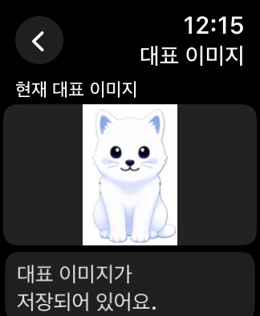
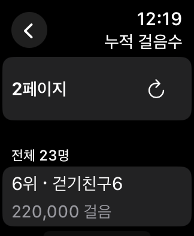

# 워치 랭킹·대표 이미지 API — 2026-11-13

`develop`에서 분기한 `feature/watch-rankings-profile` 작업이다. [Swagger 명세](https://www.stepmatecp.com/v3/api-docs)의 요청·응답 필드를 사용했다. 기존 홈 탐색 작업은 먼저 develop에 통합했다.

## 워치 사용 경로

- **스트릭 → 월별 걸음 기록 → 계정·백업 → 누적 걸음수 랭킹**: 서버에 백업된 전체 날짜의 누적 걸음수 순위. 5명씩 이전·다음 페이지와 새로고침을 제공한다. 페이지가 바뀌면 목록 상단으로 자동 이동한다.
- **게임 → 게임 선택 → 각 게임의 구간 랭킹**: 슈팅 점수, 별계단 수·최대 콤보의 페이지별 조회. 기존 TOP 10과 게임 결과 제출은 유지한다.
- **계정·백업 → 대표 이미지 변경**: 워치 사진 선택 또는 펫 이미지를 사용한다. 업로드한 대표 이미지는 사용자 정보 재조회로 불러온다.

## 연결한 계약

| 요청 | 처리 |
|---|---|
| `GET /api/v1/stepcounts/ranking?page=…&size=…` | page/size/totalUsers와 rankings(rank/userId/nickname/totalStepCount) |
| `GET /api/v1/shooting-game/rank/range?page=…&size=…` | ranks의 전체 순위·닉네임·점수 |
| `GET /api/v1/star-stair-game/rank/range?page=…&size=…` | ranks의 전체 순위·닉네임·maxStep/maxCombo |
| `PATCH /api/v1/users/me/picture` | multipart/form-data의 **image** 파일. 응답 pictureUrl |
| `GET /api/v1/users/me` | 기존 nickname과 함께 pictureUrl도 조회 |

watchOS와 중계 전송의 크기를 고려해 사진은 ImageIO로 최대 160px JPEG 썸네일을 만들고 32,000바이트 이하로 제한한다. 원본 전체 크기로 디코딩하지 않는다. 파일명과 MIME은 앱이 정하며, 401 재발급 때 같은 multipart 본문·경계를 유지한다. 파일 선택 취소나 실패는 기존 이미지를 지우지 않는다.

게임 구간 API에는 전체 인원·다음 페이지 플래그가 없다. 한 페이지가 꽉 찼을 때 다음 조회를 허용하고, 짧거나 빈 응답이면 다음 버튼을 비활성화한다. 누적 걸음수는 totalUsers로 마지막 페이지를 판단한다. 실패한 다음 페이지는 현재 페이지를 유지하며 재시도할 수 있고, 계정 변경은 늦은 응답을 폐기한다.

## 단독·중계·Debug 경계

워치 단독 모드는 워치 BackendClient로, iPhone 경유 모드는 공용 PhoneFeatureCoordinator로 호출한다. 자격 증명은 전송하지 않으며 요청·응답의 계정과 개발 환경을 검사한다. 이미지가 포함된 봉투도 기존 60,000바이트 제한을 따른다.

Debug는 각 기기의 LocalDevelopmentBackend 파일을 사용한다. 페이지를 이동할 수 있는 합성 사용자 목록을 제공하며, 대표 이미지와 URL을 모의 서버 파일에 저장한다. 재실행한 앱이 이를 다시 읽는다. Debug의 이미지 URL로 실제 네트워크 요청을 하지 않고 모의 응답의 이미지 바이트를 표시한다. iPhone과 워치의 단독 모의 서버는 서로 다른 파일이다.

Release에는 실제 HTTPS API와 PhotosPicker가 연결된다. 이번 검증에서는 운영 서버에 업로드하거나 로그인하지 않았다. Apple 인증 서버·capability 설정은 [기존 서버 명세](AppleSignInServer.md)를 따른다.

## 검증

- 공용 Core **202개 통과**: 새 API 계약·Int64 누적 합계·페이지 경계·중복/잘못된 응답·이미지 정규화와 전송 크기·multipart·401 재시도·늦은 프로필 조회·단독/중계·모의 이미지 재실행 유지.
- 워치 모델 **11개 통과**: 새 페이지 실패·재시도, 로그아웃 뒤 늦은 응답 폐기와 기존 계정/백업 회귀.
- 페어링 없는 SE 2세대 **40mm / watchOS 11**의 실제 UI **4개 흐름 통과**: 누적 걸음수 1→2→1·새로고침, 슈팅/별계단 각각 1→2→1, 펫 이미지 업로드→앱 종료/재실행→동일 대표 이미지 표시.
- 사진 라이브러리에서 개인 사진을 선택하는 동작은 수행하지 않았다. 실제 UI 검사는 같은 업로드 경로를 쓰는 **펫 이미지로 설정**을 사용했다.

- 페이지 이동 뒤 상단 표시를 직접 검사하는 랭킹 UI **3개 재검사 통과**. 새 페이지를 보기 위한 수동 스크롤이 필요 없다.
- iPhone·워치 **Release 시뮬레이터 빌드 통과**. 운영 로그인이나 API 쓰기 요청은 수행하지 않았다.
- [검증 메타데이터](Verification/CommunityAPIs-2026-11-13.json).

결과 번들: `/private/tmp/petpet-community-ui.xcresult`, `/private/tmp/petpet-community-models.xcresult`, `/private/tmp/petpet-community-pages-final.xcresult`.

## 아이폰의 달리기 감지

iOS는 Core Motion의 CMMotionActivityManager와 [running](https://developer.apple.com/documentation/coremotion/cmmotionactivity/running) 값으로 기기를 지닌 사용자의 달리기를 분류할 수 있다. 동작 및 피트니스 권한과 지원 기기가 필요하다. 현재 이 프로젝트의 iPhone NativePhonePetSprite는 인사·정지 모션만 연결되어 있고, 워치는 새 걸음수 변화에 달리기 모션으로 반응한다. iPhone의 자동 달리기 모션 연결은 이번 랭킹/프로필 기능과 별도 작업이다. 실제 센서 판별은 시뮬레이터로 확인할 수 없으므로 본 작업에서는 실기기로 시도하지 않았다.
