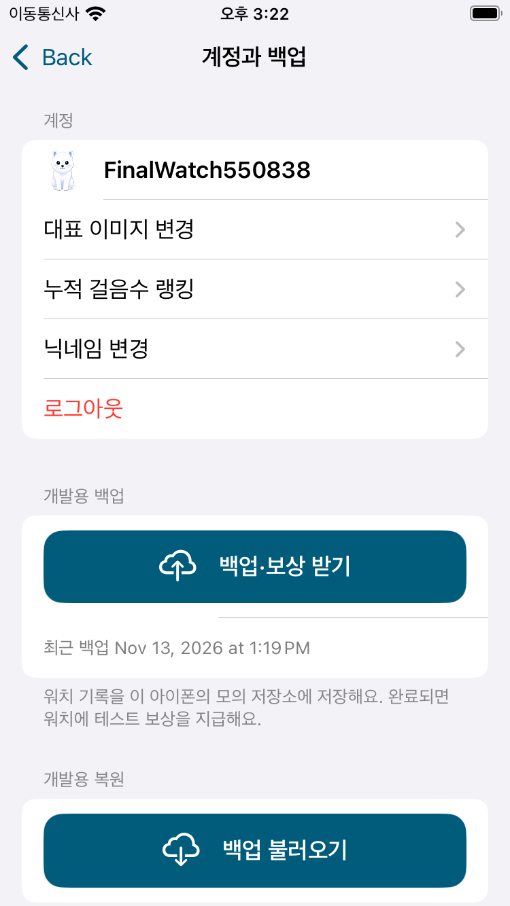
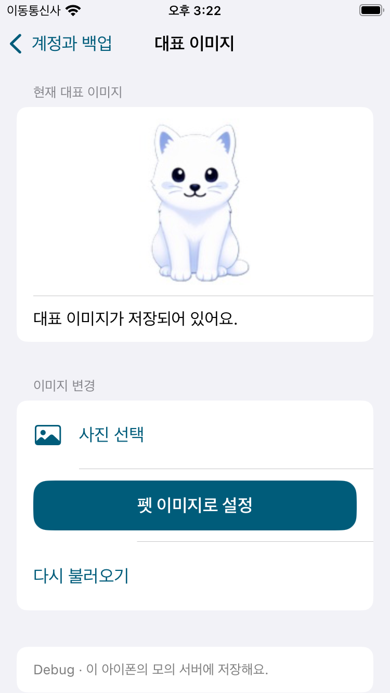
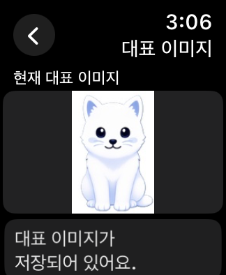

# 아이폰·워치 전체 흐름 및 새 API 최종 점검

`develop`의 `0295f86`에서 분기한 `feature/full-flow-final-audit` 작업이다. 기존 API/UI 작업은 먼저 develop에 통합했다. 실제 기기와 운영 서버를 사용하지 않고 Debug 모의 계정, XCTest와 전용 시뮬레이터만 사용했다. Mac의 마우스·창은 조작하지 않았다.

## 이번에 수정한 제품 동작

- 아이폰 대표 이미지 재조회가 성공해도 이전 오류 안내가 남을 수 있었다. 새 조회를 시작할 때 이전 오류를 지우고, 사진 선택 오류도 재조회·재선택으로 해제한다.
- 아이폰의 계정 해제·전환을 동기화 콜백으로 받는 경우에도 이전 프로필·이미지 처리 상태를 즉시 초기화한다. 늦은 이전 계정 응답은 표시하지 않는다.
- 워치 대표 이미지 화면에서 계정이 해제되면 이미지를 지우고 로그인 안내를 표시하며 사진 선택·업로드·재조회 버튼을 비활성화한다.
- 위 동작은 새 모델 회귀 네 건으로 확인했다. 기존 페이지 조회·업로드 실패·취소·로그아웃 회귀도 함께 실행했다.

추가로 아이폰 경유 새 API에서 응답이 사라지면 로딩이 계속 유지되는 상태를 재현했다. `DataReply`로 라이브 응답 대기를 30초로 제한하고 취소를 즉시 반영하며, 늦거나 중복된 콜백은 한 번만 처리한다. 시간 초과 시 연결 안내와 재조회가 가능하다. 서버에 적용됐을 수 있는 닉네임·이미지 변경 요청은 자동 재전송하지 않는다. 이 수정의 시간 초과·취소·중복/지연 응답·재전송 금지 회귀 6개를 추가했다.

구현 커밋: `1ab181d`, `7d07af8`. 검사 확장: `b66c02e`, 내비게이션 경계 보정: `d101ae5`.

## Android와 대조한 동작·출력

Android main은 [4e2b5e5](https://github.com/Chaeros/StepMate/tree/4e2b5e54902efd9630dc5fe7595ca0fb2656d0e3)로 재확인했다. API별 사용 여부와 내부 응답 필드의 처리 범위는 [25개 API 분류표](APIParity-2026-11-13.md)를 따른다.

| 영역 | 대조 기준과 검사 내용 |
|---|---|
| 워치 홈·쓰다듬기 | 전체 화면 펫과 터치 반응. 50회마다 애정도 +1 및 저장은 모델·Core 회귀, 홈 카운트 비표시와 재실행 유지는 UI 검사. 섹션 이동은 크라운·상하 탐색 사용 |
| 걸음수·스트릭 | 워치 원본 → 아이폰 수신, 날짜별 걸음수, 월·날짜 선택 후 복귀, 윤년·평년 범위 |
| 먹이·성장 | 우유/사과/고기의 경험치 1/3/5, 필요 경험치 레벨×2, 레벨업마다 스탯 포인트 +2, 재고 소비·스탯 배분·재실행 유지 |
| 백업·보상·복원 | 성공한 백업 뒤 1,000보 단위 우유와 일일 사과, 중복 지급 방지. 복원 미리보기·취소·적용, 현재 먹이·남은 포인트 보존 |
| 게임·TOP 10 | 실제 플레이·일시정지·종료·다시 하기, 제출 점수와 예상 순위, 순위·닉네임·점수/계단·최대 콤보, 새로고침·최고 기록 유지 |
| 추가 랭킹 API | 누적 합계·전체 인원·전체 순위와 게임 구간의 점수·콤보, 이전/다음 페이지. Android에는 해당 호출이 없지만 앞서 요청한 iOS 기능으로 유지 |
| 닉네임·이미지 | 워치 입력·중복 검사·변경·재실행, 아이폰 표시. 대표 이미지 변경은 Android 미호출 API를 연결한 iOS 추가 기능이며 업로드·재조회·재실행·중계 반영 검사 |
| AI | 시스템 입력, SSE 응답·완료·오류 안내, 6회 반복, 응답 중단·입력 재사용·화면 복귀·로그아웃·재로그인 |

플랫폼별 탐색·입력 UI는 유지했다. 서버의 토큰·googleId·저장 응답 메타데이터를 사용자 화면에 추가하지 않았다. 점수 저장 응답의 best/updated 값은 Android도 직접 표시하지 않는다. 워치 결과의 예상 순위 및 TOP 10 일부 실패 처리는 앞선 API/UI 작업을 유지한다.

## 검사 구성과 데이터 경계

새 iPhone SE 3세대/iOS 18와 Apple Watch SE 2세대 40mm/watchOS 11 페어에서 로그인·성장·백업/복원 9단계와 게임·AI 13단계를 연결한다. 이어 같은 페어에서 닉네임·새 랭킹·대표 이미지·큰 글자·날짜·홈 터치 15단계를 검사한다. 각 실행의 네이티브 성공·실패·건너뛰기와 대상 UDID를 검증한다. 새 API는 플랫폼별 묶음으로 실행하며 워치 업로드와 아이폰 읽기는 분리한다. 아이폰 업로드를 누르기 전에 워치 이미지의 해시·URL이 그대로인지 대조한다.

시뮬레이터에는 실제 걸음 센서가 없어 처음 생성된 워치의 걸음 기록 두 개만 준비했다(오늘 4,321보, 어제 2,000보). 계정·펫·먹이·점수·보상·이미지는 파일로 주입하지 않고 앱 UI를 사용했다. 게임 체력이나 시간 제한도 검사 편의를 위해 바꾸지 않았다. 새 API 검사 묶음마다 펫·먹이·걸음수·최고 기록·백업/복원 저널이 변하지 않는지와 아이폰 스냅샷 일치를 비교한다. 페어링 흐름이 임의로 워치 단독 모드로 바뀌지 않았는지도 검사한다.

별도 페어링 없는 40mm 워치에서는 로그인·닉네임·백업/복원·랭킹·AI와 새 API 화면·큰 글자까지 검사한다. 단독 모의 서버는 워치 파일이고, 중계 모의 서버는 아이폰 파일이다. 운영 서버처럼 두 파일의 백업·프로필 데이터가 자동 공유되는 구성은 아니다. 실제 제품은 선택한 경로에서 같은 HTTPS 서버를 사용한다.

사진 라이브러리의 개인 사진은 선택하지 않았다. 동일한 정규화·multipart 업로드 경로를 사용하는 내장 펫 이미지 버튼을 검사했다. 실제 센서·마이크 인식 품질, 운영 Apple 인증·서버 권한·업로드는 이번 검증 결과에 포함되지 않는다.

## 검사기 보완

추가된 계정 메뉴로 아래로 이동한 연결 상태와 닉네임 항목을 스크롤해 찾도록 했다. 게임 랭킹 새로고침은 버튼이 내비게이션 바 뒤에 있는 동안 누르지 않도록 검사 영역을 제한하고, 누른 뒤에도 랭킹 화면이 유지되는지 확인한다. watchOS의 첫 행은 내비게이션 바 끝에 정확히 붙으므로 별도 여백을 요구하지 않는다.

초기 단독 메뉴·게임 탐색·닉네임 시스템 입력·빌드/실행 순서의 검사기 실패와 Xcode 앱 실행 시간 초과를 진단했다. 이전 검사 번들을 빌드 완료 전에 실행한 경우도 있어 이후에는 두 빌드 완료를 확인하고 실행했다. 라이브 중계에서 응답 대기가 끝나지 않는 상태는 제품의 제한·취소 처리도 보완했다. 저장된 계정과 게임 기록은 정상이었으며 검사기의 스크롤 방향·탭 영역·경계 조건을 보완했다. 이미 성공한 먹이 소비·성장·복원은 반복하지 않고 실패한 게임 단계부터 이어간다. 최종 채택 결과와 초기 진단 결과는 검증 JSON에서 구분한다.

## 재실행

새 전용 페어를 생성·부팅한 후 다음 순서로 실행한다. 이미 소비·복원한 페어에 첫 단계부터 반복하지 않는다.

```sh
python3 -B Scripts/test_full_debug_flow.py \
  --phone NEW_PHONE_SIMULATOR_ID --watch NEW_WATCH_SIMULATOR_ID \
  --build /private/tmp/petpet-watch-ux-272 --artifacts /private/tmp/petpet-next-final

python3 -B Scripts/test_integrated_api_flow.py \
  --phone NEW_PHONE_SIMULATOR_ID --watch NEW_WATCH_SIMULATOR_ID \
  --build /private/tmp/petpet-watch-ux-272 \
  --journey /private/tmp/petpet-next-final --artifacts /private/tmp/petpet-next-api \
  --through-stage 0

python3 -B Scripts/test_api_groups.py \
  --phone NEW_PHONE_SIMULATOR_ID --watch NEW_WATCH_SIMULATOR_ID \
  --build /private/tmp/petpet-watch-ux-272 \
  --previous /private/tmp/petpet-next-api --artifacts /private/tmp/petpet-next-api-groups
```

중간 실패는 단계 검사기의 `--from-stage`, 묶음 검사기의 `--from-group`으로 이어간다. 게임 단계만 이어서 마친 경우 `test_full_debug_flow.py --from-part verify`로 네이티브 결과와 상태를 다시 집계한다. 실행 기록에는 인증 토큰과 원본 개인 사진을 남기지 않는다.

## 최종 결과

| 검증 | 결과 |
|---|---|
| 공용 Core | 213개 통과, 실패 0 |
| 앱 모델 | 아이폰 14개·워치 28개 통과, 실패·건너뛰기 0 |
| 기존 연속 흐름 | 로그인·성장·동기화·게임·AI·백업/복원 22단계 통과 |
| 새 API 화면 | 닉네임과 플랫폼별 묶음 15개 실행 통과 |
| 단독 40mm 워치 | 로그인·백업/복원·닉네임·랭킹·이미지·큰 글자·AI 8개 통과 |
| 응답 수정 후 프로필 재검사 | 워치 새 닉네임 변경·재실행 + 아이폰 명시적 종료/재실행 2개 통과 |
| 빌드 | 최신 아이폰·워치 Debug 및 Release 시뮬레이터 빌드 통과. Release 모의 코드 제외 확인 |

최종 채택 UI 실행은 **47개, 실패 0개**다. 초기 진단·실패는 별도로 기록했다. 워치 원본·아이폰 스냅샷·모의 서버의 펫 능력치·걸음수·게임 점수가 일치하며, 새 API 검사에서도 펫·먹이·걸음수·최고 기록·백업/복원 저널이 유지됐다.

워치가 변경한 닉네임이 아이폰에 표시됐고, 워치 업로드 직후와 아이폰 읽기 직후의 **이미지 SHA-256·URL이 동일**했다. 응답 수정 버전에서 닉네임을 다시 변경한 뒤 양쪽 재실행을 검사했고, 아이폰을 명시적으로 종료·재실행해도 이름과 이미지가 유지됐다.

[기기·네이티브 결과·저장값 대조·진단 기록](Verification/FullFlow-2026-11-13.json). 마지막 유지 검사 커밋은 `c3ab8f9`다.






