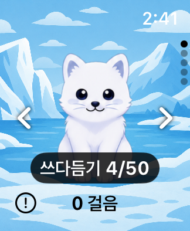

# 워치 쓰다듬기 카운트·애정도 표시

후속 요청으로 현재 앱에서는 중간 카운트 표시를 제거했다. 내부 저장·애정도 지급 규칙은 유지한다. 이 문서는 앞선 표시·저장 검증 이력이며, 현재 홈 재생과 닉네임 동작은 [최신 재점검](MotionAndNicknameAudit-2026-11-12.md)을 따른다.

## 재현과 원본 규칙

수정 전 40mm 시뮬레이터에서 실제 펫 버튼을 한 번 누르고 저장 파일을 비교했다. 카운트는 0→1로 저장됐지만 홈에는 중간 횟수 표시가 없었다. 인사 중에도 버튼은 활성 상태로 보여 추가 입력이 무시되는 이유를 알기 어려웠다.

Android의 [MateMovingImage](https://github.com/Chaeros/StepMate/blob/4e2b5e54902efd9630dc5fe7595ca0fb2656d0e3/app/src/main/java/com/chaeros/stepmate/feature_stepcounter/presentation/component/MateMovingImage.kt)는 인사·달리기 중의 중복 입력을 받지 않고, [StatisticsViewModel](https://github.com/Chaeros/StepMate/blob/4e2b5e54902efd9630dc5fe7595ca0fb2656d0e3/app/src/main/java/com/chaeros/stepmate/feature_statistics/presentation/StatisticsViewModel.kt)은 누적 50회마다 애정도를 1 올린다. 이 규칙과 중간 횟수 저장을 유지한다.

## 변경한 동작

- 저장 성공 후 홈에 `쓰다듬기 n/50`을 2초간 표시한다. 50회째에는 카운트를 0으로 돌리고 `애정도 +1!`을 표시한다.
- 인사·달리기·저장 중에는 중복 입력을 막고, 인사가 끝나면 다시 누를 수 있다. 기존 16프레임 인사 애니메이션을 유지한다. 입력이 잠겨도 펫은 흐려지지 않도록 전용 버튼 스타일을 사용한다.
- 저장 성공을 확인한 뒤 인사를 시작한다. 실패하면 저장된 카운트를 그대로 두고 실패 안내를 표시한다.
- 펫 버튼의 VoiceOver 값에도 저장된 횟수와 애정도를 제공한다. 상태 화면에서 애정도를, 스탯 상세에서 중간 카운트와 50회 규칙을 확인할 수 있다.
- 평상시 홈은 기존처럼 전체 배경·중앙 펫·걸음수 구성이다. 추가 피드백은 잠깐만 표시하고 터치를 가로채지 않는다.



## 제공받은 API 문서

[Swagger](https://www.stepmatecp.com/swagger-ui/index.html#/)가 사용하는 [공개 OpenAPI 명세](https://www.stepmatecp.com/v3/api-docs)를 2026-11-12에 읽었다. 명세 제목은 `StepMate API`, 버전은 `v1`이다.

`POST /api/v1/backup`의 `BackupSaveRequest`는 `affection`을 필수로 받고 `GET /api/v1/usermates/{mateId}`의 응답도 애정도를 포함한다. 중간 `touchCount`는 백업 스키마에 없으며 별도의 쓰다듬기 호출 경로도 기재되어 있지 않다. 터치는 워치에 저장하고 애정도는 기존 폰 동기화·서버 백업에 포함한다. 운영 서버로 로그인·백업·수정 요청을 보내지 않았다.

공개 명세에는 Google 인증·refresh가 있고 `/api/v1/auth/apple`은 기재되지 않았다. Apple 서버 계약과 모의 계정 범위는 [계정·백업](AccountAndBackup.md)을 따른다. 문서에 경로가 없는 것을 운영 서버의 실제 HTTP 응답을 검사한 결과로 취급하지 않는다.

## 검사 방법

Xcode 27.2 (27B52), Apple Watch SE 2세대 40mm / watchOS 11.0과 기존 페어 iPhone SE 3세대 / iOS 18.0 시뮬레이터만 사용했다. 실제 기기를 설치·실행하거나 사용자 화면의 창·마우스를 이동하지 않았다. 펫·횟수·시각을 테스트용으로 덮어쓰지 않고 실제 XCTest 터치로 진행했다.

- 워치: `A9079E67-24A1-43C4-A431-48DAAB3E59C8`
- 아이폰: `62CC3FF5-FBE5-44D0-93A6-A10DA462ED7E`
- 원본 로그·xcresult: `/private/tmp/petpet-touch-20261112/`
- 회귀 검사: `PetTouchModelTests`, `WatchPetTouchUITests`

```sh
xcodebuild -project PetPet.xcodeproj -scheme 'PetPet Watch App' \
  -configuration Debug \
  -destination 'platform=watchOS Simulator,id=A9079E67-24A1-43C4-A431-48DAAB3E59C8,arch=arm64' \
  -derivedDataPath /private/tmp/petpet-watch-ux-272 \
  ONLY_ACTIVE_ARCH=YES ARCHS=arm64 CODE_SIGNING_ALLOWED=YES CODE_SIGN_IDENTITY=- \
  '-only-testing:PetPet Watch AppTests/PetTouchModelTests' \
  '-only-testing:PetPet Watch AppUITests/WatchPetTouchUITests' test
```

50회 검사는 현재 횟수에서 시작해 모든 입력의 저장 결과를 확인한다. 25회 뒤 재실행하고 마지막에도 재실행해 중간 카운트와 애정도를 확인한다. 기존 Debug 기록의 애정도가 실제로 증가하므로, 이 검사를 데이터가 전혀 바뀌지 않는 화면 점검으로 취급하지 않는다.

## 검증 결과

- 모델 4개: 50회 경계와 파일 재로드, 저장 실패 시 성공 표시 금지, 첫 로드 전 기존 애정도를 새 보상으로 잘못 표시하지 않기, 인사 중 입력 대기와 완료 후 재활성화가 통과했다.
- UI 3개: 40mm 큰 글씨 카운트와 재실행, 실제 50회 입력과 25회·50회 뒤 재실행 및 상태 화면 애정도, 상세 목록의 저장된 카운트 확인이 통과했다.
- 최종 50회 실행에서는 횟수 2·애정도 1에서 시작했다. 48번째 입력으로 카운트 0·애정도 2가 되고, 50번째 입력 후 횟수 2·애정도 2가 저장됐다. 모든 입력의 UI 값이 예상과 같았다.

초기 50회 검사에서도 입력·저장과 애정도 증가까지 확인됐지만 마지막의 전체 화면 스와이프가 상세 카운트 행을 건너뛰어 실패했다. 상세 검사를 짧은 겹침 스크롤로 분리하고 50회 흐름도 다시 실행해 통과했다.

추가 캡처 검토에서는 대기 중 기본 plain 버튼 스타일이 펫까지 흐리게 만드는 것을 발견해 전용 스타일로 바꿨다. 일시 안내가 사라지는 시점과 XCTest의 프레임 조회가 경쟁하는 검사도 있었다. 큰 글씨 화면 검사에만 Debug `--watch-ui-hold-touch-feedback`을 사용해 **실제로 저장된 표시값**을 유지한다. 일반 실행의 2초 안내 시간·게임 규칙·저장 데이터는 바꾸지 않으며, 이 인수는 Release 실행 파일에 포함되지 않는다. 해당 시각 검사와 재실행 확인도 통과했다.

Debug 테스트 빌드와 최종 아이폰·워치 Release 시뮬레이터 빌드가 성공했다. Debug 실행 파일에만 화면 검사 인수가 존재하는 것을 확인했다. 추가 시각 검사에서도 실제로 터치했으므로 최종 Debug 기록은 카운트 4/50·애정도 2다. 아이폰이 수신한 펫·먹이·걸음 기록이 최종 워치 저장값과 같았다. 애정도·중간 횟수·최근 활동 시각 외의 펫 수치, 먹이·걸음 기록·보상 수령 내역과 백업·복원 ID 집합은 보존됐다.

구현은 `63c5fef`, 펫 선명도와 화면 검사 보완은 `54cadaa`에 커밋했다. 중간 실패와 최종 채택한 xcresult, 50개 입력의 측정값, 서버 문서의 해시와 데이터 보존·동기화 결과는 [검증 JSON](Verification/PetTouchSimulator-2026-11-12.json)에 남긴다.

[저장된 중간 카운트](Screenshots/PetTouch/pet-touch-saved-count-detail.png), [재실행 후 애정도](Screenshots/PetTouch/pet-touch-status-after-relaunch.png)
