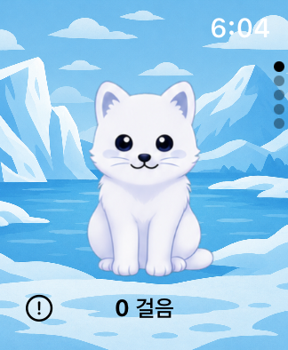

# 워치 홈 탐색 — 2026-11-12

사용자 요청으로 워치 홈의 좌우 페이지 화살표를 제거했다. 화면 이동은 watchOS 기본 크라운·상하 스와이프를 사용한다. 순서는 **홈 → 상태 → 게임 → 스트릭 → AI 대화**이며, 먹이·스탯은 상태 페이지에서 연다.

펫 터치 영역은 화살표용 여백을 없애고 캐릭터 너비에 맞췄다. 40mm 측정값은 **97×128pt**다. 쓰다듬기·걸음수와 상세 화면의 기존 기능은 유지한다. 기존 UI 검사에서 제거한 버튼으로 이동하던 부분도 공통 크라운 탐색 헬퍼로 변경했다.

## 검증

SE 2세대 40mm / watchOS 11 시뮬레이터에서 XCTest **4개 통과**, 실패 0개. 실기기와 데스크톱 창 이동은 사용하지 않았다.

- 낮 홈: 화살표 없음, 펫·걸음수 표시, 상하 스와이프 왕복.
- 큰 글자·밤 홈: 같은 표시·스와이프 왕복 및 터치 영역 확인.
- 크라운으로 5개 페이지 이동, 먹이·스탯·게임·계정 상세 접근, 마지막 페이지 유지.
- 펫 터치 후 앱 재실행과 저장 상태 유지.

결과: `/private/tmp/petpet-home-navigation-40mm.xcresult`.

