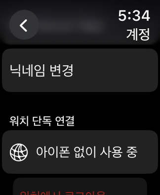
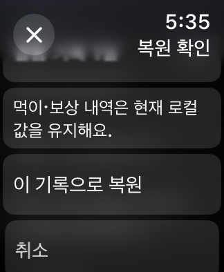
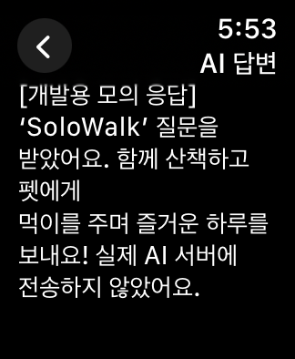

# 워치 단독 연결 — 2026-11-12

## 사용 방법

1. 워치 크라운으로 **스트릭 → 월별 걸음 기록 → 계정**을 연다.
2. Debug에서는 **워치에서 개발용 로그인**을 누른다. Release는 네이티브 Apple 로그인이다.
3. **아이폰 없이 사용 중**이 표시되면 닉네임·백업/보상·백업 기록 불러오기/확정을 사용할 수 있다. 게임의 TOP 10·결과 제출과 AI 대화도 워치 자체 세션을 사용한다.
4. 단독 모드는 재실행·로그아웃·인증 만료 후에도 유지한다. **아이폰 연동으로 전환**을 직접 눌러야 기존 중계 모드로 돌아간다.

`WKRunsIndependentlyOfCompanionApp=true`로 companion iPhone 앱 없이도 실행할 수 있다. Release 서버 기능에는 워치의 Wi-Fi/셀룰러 인터넷 연결이 필요하다. 워치 펫·먹이·걸음수 원본과 기존 WatchConnectivity 동기화는 계속 유지한다.

## 구현과 데이터 경계

- `WatchStandaloneService`: 자체 BackendClient, 인증 상태, 닉네임, 백업·복원, 성공 저널 복구를 소유한다.
- `WatchFeatureRouter`: 단독/아이폰 요청 경로를 전송 전에 결정한다. 실패한 POST를 다른 경로로 재전송하지 않으며, 채팅은 시작한 경로에서 조회·취소한다.
- 공용 `BackendClient`의 HTTPS·401 refresh·회전 토큰 저장·계정 epoch 검사, 기존 `PhoneFeatureCoordinator`의 SSE 작업·제한·취소 로직을 워치에서도 재사용한다. 단독 모드의 기능 요청·채팅 조회는 WatchConnectivity를 호출하지 않는다.
- `WatchAppleSignInProvider`: 워치 자체 nonce/state와 네이티브 Apple 증명을 서버에 교환한다. iPhone 자격 증명을 워치로 전달하지 않는다.
- `WatchKeychainSessionStore`: 워치 전용, 서버별 service. `AfterFirstUnlockThisDeviceOnly`로 저장한다. mode·표시 계정·영수증 파일에는 access/refresh token을 저장하지 않는다.
- 늦은 iPhone 계정/로그아웃은 별도 companion 캐시에 보관하고 활성 단독 계정을 덮어쓰지 않는다. 모드를 명시적으로 전환하면 최신 companion 계정을 다시 표시한다.
- 백업은 센서 기록을 먼저 저장하고 기존 전체 증분 내보내기를 사용한다. 서버 성공 영수증을 디스크에 먼저 기록한 뒤 기존 원자적 보상 처리를 적용한다. 연속 탭·재실행·영수증 재처리는 보상을 중복 지급하지 않는다.
- 복원 조회는 로컬 펫을 변경하지 않는다. 화면 확인 후에만 적용하며 조회 이후 먹이 등으로 펫이 바뀌면 거절한다. 승인된 복원 저널은 재실행 시 복구하고, 오래된 대상은 폐기한다.

## Debug와 운영의 차이

워치 Debug 모의 서버는 `Development/standalone-mock-backend-v1.json`에 저장하며 워치가 자체 로그인한다. 이 파일의 토큰은 합성 테스트 값이고 실제 Apple/운영 토큰이 아니다. 아이폰의 모의 서버와 서로 다른 파일이므로 모의 서버 데이터가 기기 사이에서 공유되는 것은 아니다. 기존 iPhone 연동 모드에서는 같은 iPhone 모의 서버를 사용하는 종전 테스트를 계속할 수 있다.

Release는 실제 URLSession과 `PetPetAPIBaseURL`을 사용한다. 워치용 Apple capability/프로파일, `/api/v1/auth/apple`의 watch audience와 기기별 토큰 세션 지원은 [서버 변경 명세](AppleSignInServer.md)를 따른다. 이번 작업은 서버를 배포하거나 운영 계정으로 호출하지 않았다.

## 검증

모든 실행·설치·검사는 시뮬레이터와 Debug 모의 계정으로 수행했다. 실기기 설치 및 화면 이동은 하지 않았다. UI 조작은 사용자가 허용한 XCTest로 수행한다.

- 공용 Core: **191개 통과**, 단독 기능 8개 포함. 아이폰 전송을 항상 실패시키는 spy를 연결하고 닉네임·백업/보상·복원·두 게임 랭킹 제출·SSE 완료를 검사했다. 실제 companion 호출은 0회였다. 재실행 로그인 유지, 저장된 성공 영수증 복구, 중복 보상, 오래된 복원 거절, 동시 백업 탭, 세션 만료 후 자동 중계 방지도 포함한다.
- 네이티브 워치 모델: 기존 cloud 6개 + 단독 controller 3개, **9개 통과**. 늦은 아이폰 계정·로그아웃·전송 오류 격리, 폰 파일 전송 없는 백업/복원, 명시적인 중계 전환을 확인했다.
- 네이티브 UI **3개 흐름 통과**: 자체 로그인 → 연속 백업 → 복원 미리보기/확정 → 재실행 계정 유지, 닉네임 변경 → 재실행 유지, 랭킹 조회 → 실제 시스템 텍스트 입력 → AI 응답 완료. 첫 전체 실행에서 AI 시스템 입력 완료가 시간 초과되어 입력 방식 전환 대기를 추가했고, 해당 사례만 재실행해 통과했다. 입력 우회나 테스트 질문 주입은 추가하지 않았다. 결과 번들은 `/private/tmp/petpet-standalone-native-final.xcresult`(모델 9개와 앞 UI 2개 통과) 및 `/private/tmp/petpet-standalone-ai-complete.xcresult`(보완한 마지막 UI 1개 및 전체 답변 마지막 문장 가시성 통과)다.
- iPhone + 워치 **Release 시뮬레이터 빌드 통과**. 두 Mach-O의 심벌에서 `LocalDevelopmentBackend`와 `signInForDevelopment`가 제외된 것을 확인했다. 실제 Apple 인증은 수행하지 않았다.
- [검증 메타데이터](Verification/WatchStandalone-2026-11-12.json), [40mm 화면 캡처](Verification/WatchStandalone-2026-11-12/).
- 전용 UI 대상: **PetPet Standalone 40mm**, SE 2세대/watchOS 11, `239DFD2B-8250-409E-9B90-FF960B5BA636`. iPhone과 페어링하지 않았다. 최초 실행의 피트니스 권한 팝업은 XCTest에서 허용한다.

재현 명령은 아래와 같다. 전체 UI 테스트는 로그인 전의 새 전용 워치를 대상으로 하며 10 → 20 → 30 순서로 실행한다. 기존 로그인 상태에서는 필요한 사례를 `-only-testing`으로 선택한다. 시뮬레이터를 새로 만들 경우 먼저 해당 runtime/device type을 설치한다. 실기기 destination을 사용하지 않는다.

```sh
swift test --package-path Packages/PetPetCore --scratch-path /private/tmp/petpet-standalone-core --jobs 2
xcodebuild -project PetPet.xcodeproj -scheme 'PetPet Watch App' -configuration Debug \
  -destination 'platform=watchOS Simulator,id=239DFD2B-8250-409E-9B90-FF960B5BA636,arch=arm64' \
  -derivedDataPath /private/tmp/petpet-watch-ux-272 -jobs 2 -parallel-testing-enabled NO \
  ONLY_ACTIVE_ARCH=YES ARCHS=arm64 CODE_SIGNING_ALLOWED=YES CODE_SIGN_IDENTITY=- \
  '-only-testing:PetPet Watch AppTests/WatchStandaloneControllerTests' \
  '-only-testing:PetPet Watch AppTests/WatchCloudControllerTests' \
  '-only-testing:PetPet Watch AppUITests/WatchStandaloneUITests' test
```

## 40mm 긴 답변 읽기

watchOS List의 행 높이 제한으로 긴 AI 답변의 마지막 줄이 말줄임되었다. 목록에는 4줄 미리보기를 두고, 응답 완료·중단 후 **답변 전체 보기**로 별도 ScrollView를 연다. 긴 단일 Text도 말줄임되는 40mm 표시를 피하도록 48글자 이하의 짧은 문단으로 나누되 모든 문자와 공백을 보존해 끝까지 읽도록 수정했다. 스트리밍 중에는 중단 버튼을 우선하며 전체 읽기 링크는 응답 작업이 끝난 뒤 표시한다.

## 40mm 검토 화면




